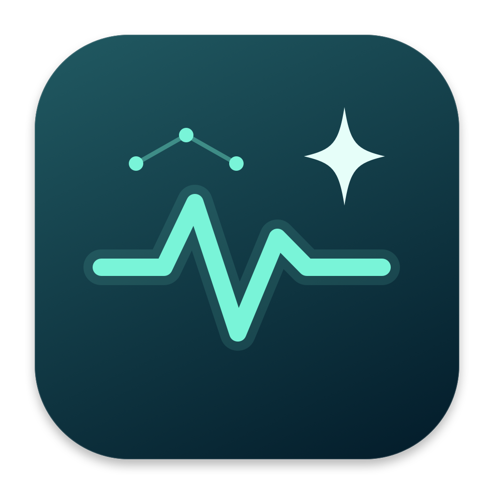
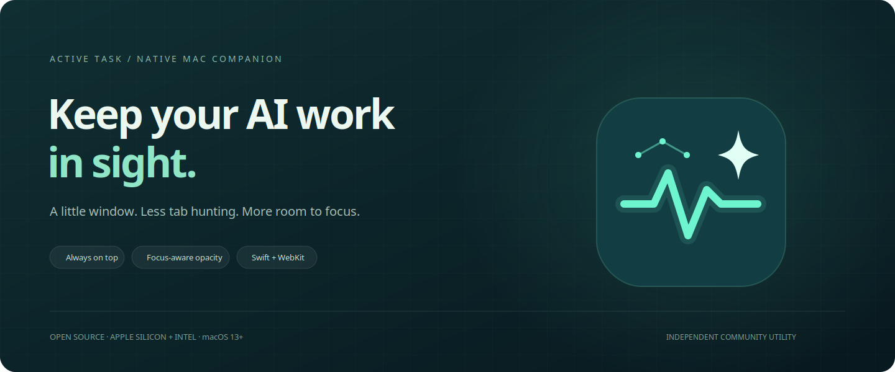
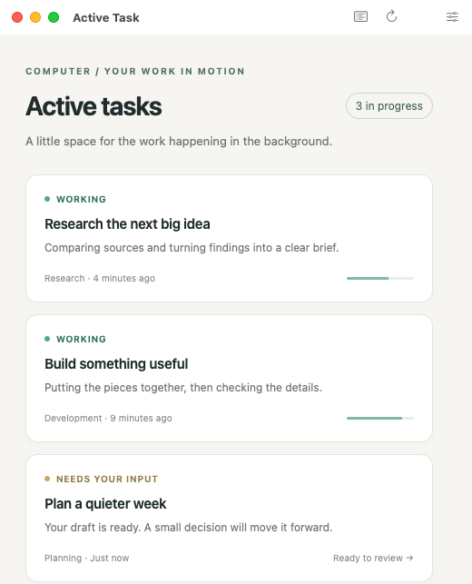
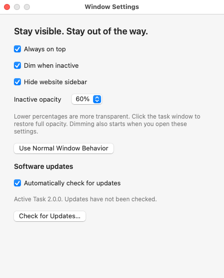
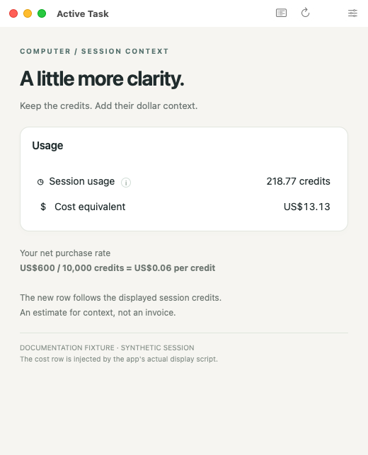
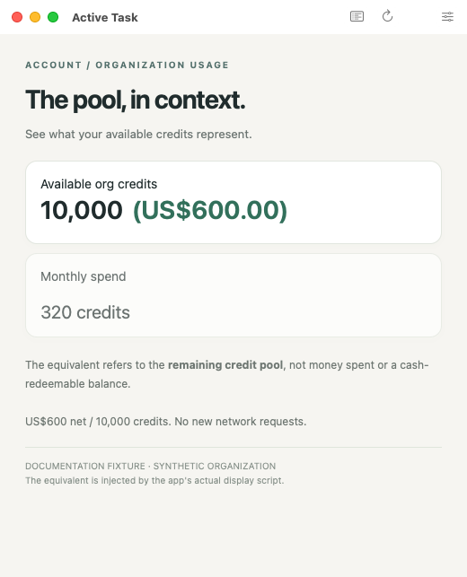

<div align="center">
  
  <h1>Active Task</h1>
  <p>Your AI work. Quietly in view.</p>
  <p>
    <a href="https://github.com/paulfxyz/perplexity-active-task/releases/latest"></a>
    <a href="LICENSE"></a>
    
    
    
    <a href="https://github.com/paulfxyz/perplexity-active-task/actions/workflows/build.yml"></a>
  </p>
  <p><a href="https://github.com/paulfxyz/perplexity-active-task/releases/latest">Download for Mac</a> · <a href="INSTALL.md">Install guide</a> · <a href="CHANGELOG.md">Changelog</a> · <a href="PRIVACY.md">Privacy</a> · <a href="CONTRIBUTING.md">Contribute</a></p>
  
</div>

## Your tasks, without the tab hunt

Active Task is a tiny native Mac companion for [Perplexity Computer's active tasks](https://www.perplexity.ai/computer/tasks?status=active). It puts the existing website in a compact, resizable window, with the sidebar hidden where possible and a login session that survives relaunching.

Keep it above your other windows, let it fade when you are working elsewhere, or use it like an ordinary window. It also adds clearly qualified USD equivalents to visible session usage and organization credits. No Electron runtime, API key, browser extension, or project-operated backend is required.

It is a window onto Perplexity, not a second task engine. You still need a Perplexity account with access to Computer, and the app cannot add account features or bypass website restrictions.

## Install or update

1. Download **Active-Task-macOS-universal.zip** from the [latest release](https://github.com/paulfxyz/perplexity-active-task/releases/latest).
2. Unzip it, move **Active Task.app** to Applications, and open it.
3. Sign in directly inside the app. Use the sliders button or **Active Task → Settings…** to choose your window behavior.

Upgrading from 1.x? Install **2.0.0 manually once**: older versions do not contain the new updater. Quit the app, replace it, and reopen. The bundle identifier stays the same, so preferences and the app's WebKit session remain associated with the same application.

From 2.0.0 onward, use **Active Task → Check for Updates…** or the button in Settings. Optional automatic checks run after launch and every six hours, but installation always requires **Download & Restart** confirmation. Updates are downloaded, verified, staged, and installed in place; the previous app is retained for recovery. See [the update process and its limits](docs/UPDATES.md).

**Community build: ad-hoc signed, not Developer ID signed or Apple-notarized.** macOS may require approval in Privacy & Security. Do not disable Gatekeeper or management policies to install; see the [installation and troubleshooting guide](INSTALL.md).

<div align="center">
  
</div>

The overview uses synthetic tasks in a separately compiled documentation build, not your account or the live Perplexity interface. Screenshots combine the running app's native window frame with an actual WebKit snapshot; see [how they are captured](docs/SCREENSHOTS.md).

## What you get

- **A small native window:** Starts at 520 × 700, resizes down to 360 × 360, and remembers its position and size.
- **Always on top:** Keep the task window floating above ordinary windows, or turn floating off.
- **Optional inactive dimming:** Choose **5%, 10%, 20%, 30%, 40%, 50%, 60%, 70%, 80%, 90%, or 95% opacity**. Lower means more transparent; focusing the task window restores 100%.
- **Normal window behavior:** One action disables both floating and dimming so other windows naturally cover it.
- **A real settings panel:** Open Settings with **⌘,**. Floating and dimming are independent; selecting an opacity level turns dimming on.
- **Persistent sign-in:** A dedicated local WebKit session, separate from Safari or Comet. There is no cookie import from another browser.
- **A quieter sidebar:** Conservative, reversible suppression of known sidebar elements, with an explicit collapse-button fallback.
- **Mac integration:** Menu-bar restore, native file saving, keyboard shortcuts, zoom, and sign-in popup windows.
- **Cost context, inline:** A **Cost equivalent** row below Session usage and a dollar equivalent beside Available org credits, using the explicit net rate described below.
- **In-app updates:** A version check, download progress, verified replacement/restart, optional background checks, and a previous-app backup. No silent installations or administrator prompts.
- **Original artwork:** A mint activity waveform, connected neural nodes, and an AI sparkle. No copied Perplexity app icon.

<div align="center">
  
</div>

Fresh installations default to floating on, dimming off, and 60% inactive opacity when enabled. Settings changes apply immediately; opening Settings takes focus away from the task window, so dimming can become visible while you adjust it.

## Three ways to keep it nearby

| Mode | Always on top | Dim when inactive | What happens |
| --- | --- | --- | --- |
| Persistent companion | On | Off | Stays above ordinary windows at full opacity |
| Quiet companion | On | On | Stays above ordinary windows, fading to your chosen opacity when unfocused |
| Ordinary window | Off | Off | Other windows naturally cover it |

Dimming also works with floating off. The app does not make transparent areas click-through, keep your Mac awake, or guarantee visibility above system dialogs, other elevated windows, or across every full-screen/Spaces arrangement.

## Credits are a unit. Dollars are context.

Version **2.0.0 corrects the conversion to US$0.012 per credit**, based on the clarified packs: **10,000 credits for US$120, 50,000 for US$600, or 100,000 for US$1,200**. This is an account-specific net purchase assumption, not an official pricing feed or universal tariff.

**1.1.0 used US$0.06 per credit and overstated equivalents fivefold under these corrected prices.** Upgrade before using its estimates; the underlying Perplexity credit counts were never modified.

| Display | What the equivalent means |
| --- | --- |
| Session usage → Cost equivalent | The displayed session credits used, multiplied by US$0.012 |
| Available org credits → `(US$…)` | The equivalent of the remaining shared credit pool, not money spent or cash redeemable |

For example, **218.77 credits → US$2.63**, **11,717.13 credits → US$140.61**, and **10,000 available credits → US$120.00**. Original credit values remain unchanged; the additions follow readable DOM updates and disclose the rate on hover. Positive values below a cent show `<US$0.01`, not zero.

<table>
  <tr><th align="left">Session usage</th><th align="left">Organization pool</th></tr>
  <tr>
    <td></td>
    <td></td>
  </tr>
</table>

These are captures of the app's real display script acting on synthetic, native-structure fixtures, not a private account. English labels and explicit numeric values are supported; unreadable counts are unavailable, not assumed to be free, and compact values such as `10k` are not expanded into false precision.

Use **View → Organization Usage** or **⌘2** to open the organization page. You need the appropriate account access; the app does not grant organization permissions.

The calculation is local and adds no network requests. It is **not an invoice, cost forecast, live billing API, spending cap, or tax calculation**. If your purchase rate differs, the hard-coded assumption must be changed and the app rebuilt; see [cost calculation and limits](docs/COST_EQUIVALENT.md).

## Keyboard shortcuts

| Shortcut | Action |
| --- | --- |
| ⌘, | Open settings |
| ⌘1 | Return to active tasks |
| ⌘2 | Open organization Usage |
| ⌘R | Reload |
| ⌘B | Open current page in the default browser |
| ⌘+ / ⌘− / ⌘0 | Zoom in / out / reset |
| ⌘W | Close the window; keep the app in the menu bar |
| ⌘Q | Quit |

## Local session, real website

```text
Perplexity website in a persistent WKWebView
                    │
          Native resizable AppKit window
                    │
    Floating + opacity + sidebar + local USD equivalents
                    │
       Local preferences and WebKit session
```

The website handles your account and tasks. Active Task adds window behavior and locally converts the displayed credit counts; it does not request API credentials, copy browser cookies, log page contents, or relay your task data through a separate service.

Page-enhancement scripts run only on Perplexity's main frame in WebKit's isolated content world, without a JavaScript-to-native command bridge. Normal WebKit TLS and web-security behavior remain enabled. External HTTP(S) links open in your browser, and downloads ask where to save.

“Local” does not mean offline: the embedded Perplexity website and its identity providers load their own resources. See [Privacy](PRIVACY.md), [Security](SECURITY.md), and the [architecture notes](docs/ARCHITECTURE.md).

## What to expect

- **Sign-in policies vary:** Some Google, Apple, SSO, or verification flows reject embedded browsers. Use Perplexity's email/code option if offered; this app does not bypass provider policies.
- **Browser login is separate:** Opening the same page in Safari or Comet does not sign the app in. Email verification links may open externally; return to the app and enter a code if available.
- **Sidebar hiding is best-effort:** Perplexity can change its markup. The app deliberately does not hide generic navigation or guess at hashed CSS classes.
- **Closing is not quitting:** Restore the window from the activity-wave menu-bar icon. Use Quit to stop the app.
- **This is not an official integration:** There are no native task notifications, task-count badge, background-task or billing API, unattended installations, or offline task sync.
- **Validation has limits:** CI builds both architectures, tests behavior, checks signing integrity, launches the app, and generates fixture screenshots. It does not establish live sign-in compatibility or account-specific sidebar behavior; see [validation notes](docs/VALIDATION.md).

## Develop and test

Requires macOS 13+ and Apple's Xcode Command Line Tools to build. The shipping app has no third-party runtime or Swift-package dependencies. Node.js 22 and the development-only jsdom package are used for JavaScript/DOM tests.

```sh
git clone https://github.com/paulfxyz/perplexity-active-task.git
cd perplexity-active-task
bash scripts/build.sh
open "build/Active Task.app"
```

```sh
npm ci
npm test
mkdir -p build
xcrun swiftc Sources/Behavior.swift tests/WindowBehaviorTests.swift -o build/behavior-tests
build/behavior-tests
```

The build creates a universal executable, generates the original icon using AppKit, ad-hoc signs and verifies the bundle, and produces a ZIP plus SHA-256 checksum. Screenshot fixtures are compiled into a separate documentation build only and are excluded from release bundles.

Contributions, bug reports, and focused improvements are welcome. Start with [Contributing](CONTRIBUTING.md).

## Companion projects

- **[AI Credit Checker](https://github.com/paulfxyz/ai-credit-checker):** A separate menu-bar dashboard for available balances across AI and infrastructure providers.
- **[Perplexity Cost Transparency](https://github.com/paulfxyz/pplx-cost-transparency):** The browser-extension inspiration for inline USD context. Active Task reuses its conservative parsing approach and now uses the corrected **US$600 net / 50,000 credits** assumption.

## Open source, honestly

### Disclaimer: 100% vibe coding

Built by **Paul Fleury** with AI assistance. I am an entrepreneur building useful software with AI, not presenting this as the work of a traditional full-time software engineer.

The code is open so it can be inspected, challenged, and improved. Tests and explicit limitations matter more than claims of perfection; treat this as a community utility, not a security-certified or official Perplexity client.

Active Task is independent and is not affiliated with or endorsed by Perplexity or Apple. Perplexity's website and trademarks remain their owners' property; the code and original app artwork here are independently produced.

## License

MIT. Source code, original artwork, documentation, and synthetic screenshot fixtures are covered by [LICENSE](LICENSE). Third-party websites, trademarks, and platform frameworks are not relicensed by this project.
